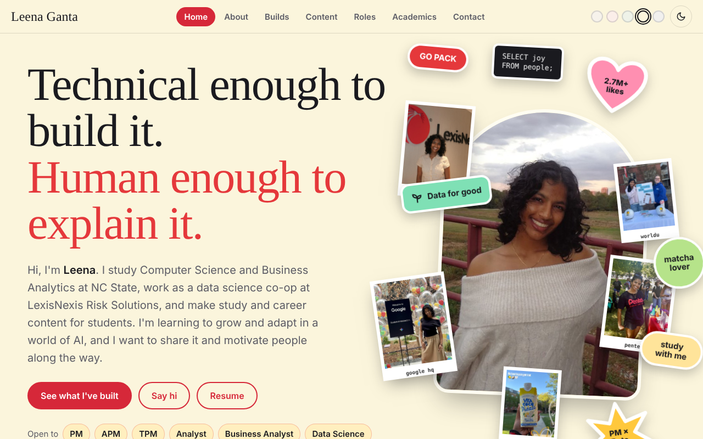

# Leena Ganta | Portfolio

**Technical enough to build it. Human enough to explain it.**

Hi, I'm Leena! I'm a junior at NC State studying Computer Science and Business Analytics (minor in Data Science). This is my interactive portfolio, where I put the stuff I've built, the content I make, and the roles I've had in one place.

**Live site:** https://leenarganta.github.io/digital_portfolio/

---

## What's on the site

- **Home**: who I am and the roles I'm open to (PM, APM, TPM, analyst, business analyst, and data science)
- **About**: the story behind the resume
- **Builds**: data pipelines and AI tools with real users
- **Content**: my study and career content for students on TikTok (~8K followers, 2.7M+ likes), where I share what I'm learning about growing with AI
- **Roles**: ambassador programs and leadership, in clickable cards
- **Academics**: degree, coursework, and tech stack
- **Contact**: say hi!

## Featured builds

- **Engineering Visibility Dashboard**: a full-stack, AI-assisted tool I built during my LexisNexis internship so product managers can see what an engineering team is working on, what it committed to, and whether it delivered. The site has a case study with test-account screenshots. The code isn't in this repo because it's internal work.
- **Agent Gong**: an AI call-analysis pipeline I helped expand into new business segments, with LLM evaluation using RAGAS. Described at a high level only.
- **Raleigh open data project**: I'm a project lead in NC State's Data Analytics Club, working with the City of Raleigh's data sets. (In progress)
- **bank_marketing_campaign**, **My-Color-Recognizer**, **Instagram-Swipe-App**: smaller projects on my [GitHub](https://github.com/leenarganta).

## Built with

- Plain HTML, CSS, and JavaScript in a single page (no framework, no build step)
- Light and dark mode, plus background color swatches
- Responsive layout for phones and laptops
- Designed and iterated with Claude. The content, direction, and decisions are mine, which matches my rule on everything I build: **the AI proposes, a person decides.**

## Run it locally

1. Download or clone this repo
2. Open `index.html` in your browser

That's it!

## A note on privacy

No customer data, company data, or internal code is shown anywhere on this site. Screenshots use test accounts, and team names and work item titles are removed.

## Contact

- LinkedIn: [linkedin.com/in/leenarganta](https://www.linkedin.com/in/leenarganta)
- Email: lrganta@ncsu.edu
- TikTok: [@winglvr13](https://www.tiktok.com/@winglvr13)
